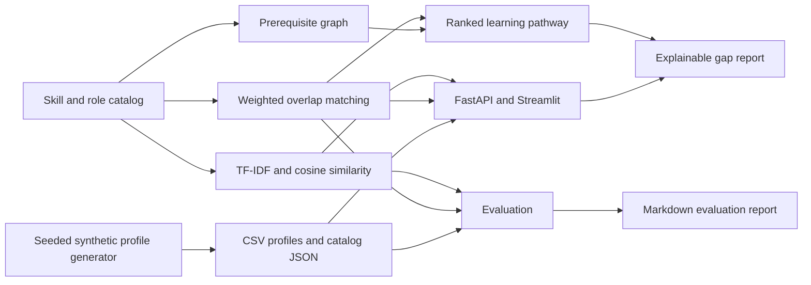

# Architecture

The weighted score uses only student skill levels and each target role's importance/required-level values. TF-IDF cosine similarity is a separate text signal, and is combined only in the explicit hybrid role-ranking mode. Recommendations traverse skill prerequisites before dependent items and attach a reason and learning resource to every step. All generated student records are synthetic.
